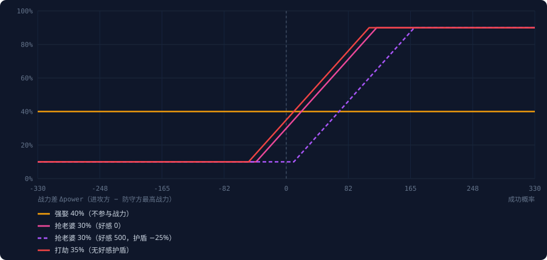
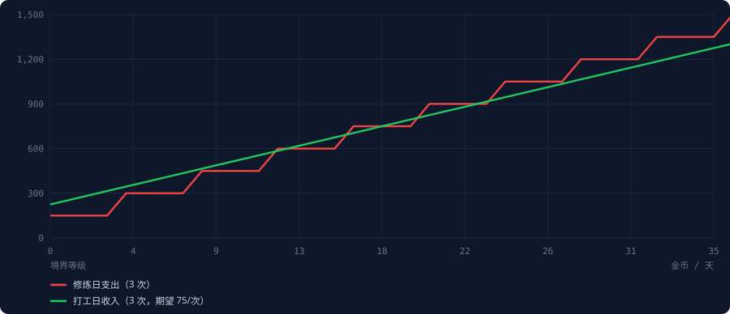

# partner-game 功能分类与维护地图

> 由 `docs/tools/gen_maintenance_map.py` + `gen_dashboard.py` 从源码静态生成，重构后重新运行即可刷新。可视化版本见 `docs/dashboard.html`。

## 0. 概览

| 指标 | 值 |
|---|---|
| 插件 | 今日老婆 Pro+ (tianditongcuo.partner-game-pro) |
| 版本 | 2.0.2 |
| 指令数 | 24 |
| plugin.py | 1841 行 |
| config.py | 113 行 |
| utils.py | 113 行 |
| __init__.py | 2 行 |
| 配置项 | 17 |
| 持久化表 | marriages、users、daily_usage、last_date |
| 测试 | 0 |

## 1. 功能域分类

| 域 | 职责 | 指令数 | 代码行 | 关键位置 |
|---|---|---:|---:|---|
| **入口与路由** | 指令注册、消息守卫、@目标解析、切片上下文 | — | 0 | `plugin.py:397-1873`；`plugin.py:44-114`；`plugin.py:116-146` |
| **婚姻关系** | 抽取/求婚/强绑/抢夺/解绑/查询，marriages 表的唯一所有者 | 7 | 510 | `plugin.py:397-535`；`plugin.py:660-738`；`plugin.py:587-658` |
| **经济财富** | 金币产出与消耗、罚款与赔偿、转账 | 3 | 121 | `plugin.py:322-333`；`plugin.py:1402-1429`；`plugin.py:1431-1478, 1480-1546` |
| **修仙成长** | 境界等级、修炼消耗与突破、战力换算 | 1 | 58 | `realms.py:29-34`；`plugin.py:1499-1500`；`plugin.py:1512-1540` |
| **战斗结算** | 概率公式、战力压制、好感护盾、胜率预测 | 4 | 327 | `plugin.py:1030-1033`；`plugin.py:796-802`；`plugin.py:1015-1033` |
| **惩罚与限次** | 冷却、每日次数、失败自闭、罚款、掉级 | — | 0 | `plugin.py:376-386`；`plugin.py:343-373`；`plugin.py:388-394` |
| **展示与输出** | NapCat 直发、合并转发、头像、榜单、帮助文案 | 6 | 207 | `plugin.py:177-194`；`plugin.py:204-227`；`utils.py:16-36` |
| **数据与持久化** | JSON 存档、防抖写盘、跨日重置 | — | 0 | `utils.py:50-113`；`utils.py:81-104`；`plugin.py:348-355` |
| **配置** | 17 个可调参数与管理员/白名单 | — | 0 | `config.py:8-19`；`config.py:24-38`；`config.py:39-48, 94-102` |
| **管理运维** | 重置、全服补偿、定向发钱 | 3 | 112 | `plugin.py:1728-1732`；`plugin.py:1719-1761`；`plugin.py:1763-1796` |

> 「入口与路由 / 惩罚与限次 / 数据与持久化 / 配置」是**横切关注点**：它们没有专属指令，而是被其它域共享，因此指令数为 0。
### 1.1 各域明细

#### 入口与路由 `router`

| 功能点 | 说明 | 位置 |
|---|---|---|
| 指令注册 | @Command 装饰器 × 24，pattern 为裸正则，部分未加 `$` 锚点 | `plugin.py:397-1873` |
| 上下文解析 | _extract_ctx 从 kwargs 里挖 group_id / sender_qq；_extract_at_qq 有 4 层兜底（含整串正则） | `plugin.py:44-114` |
| 消息守卫 | _is_explicit_command 判断是否以 / 开头；_has_quote 判断是否回复消息 | `plugin.py:116-146` |
| 生命周期 | on_load 建 data 目录；on_unload 取消防抖任务并强存 | `plugin.py:18-35` |

#### 婚姻关系 `marriage`

| 功能点 | 说明 | 位置 |
|---|---|---|
| 随机抽取 | /今日老婆：置随机数种子后从群成员池抽人，并【立即绑定】，不经过对方同意 | `plugin.py:397-535` |
| 求婚 | /娶：发 @ 消息 + pending_proposals[msg_id] 内存态，60s 超时 | `plugin.py:660-738` |
| 求婚应答 | 收到含「我同意/我拒绝」的消息时比对 pending_proposals | `plugin.py:587-658` |
| 强制绑定 | /强娶：纯概率 40%，无战力参与 | `plugin.py:740-836` |
| 抢夺 | /抢老婆：带战力差与好感护盾的复合概率 | `plugin.py:949-1082` |
| 解绑 | /离婚（发起方）/甩掉（被绑定方），各自每日 1 次 | `plugin.py:538-585, 889-947` |
| 查询 | /我的伴侣：支持 @ 查他人 | `plugin.py:838-887` |

#### 经济财富 `economy`

| 功能点 | 说明 | 位置 |
|---|---|---|
| 初始与低保 | 建号 1000；每日首次读取用户数据 +200（副作用藏在 getter 里） | `plugin.py:322-333` |
| 劳动收入 | /打工：50~100 + 等级×10，每日 3 次 | `plugin.py:1402-1429` |
| 消费 | /约会 50/次（换好感）；/修炼 (大境界+1)×50/次 | `plugin.py:1431-1478, 1480-1546` |
| 转移 | /上交存款：双方余额各改一次，无手续费 | `plugin.py:1584-1631` |
| 罚款与赔偿 | 失败罚款的 50% 转给对方，另 50% 凭空蒸发（隐形回收池） | `plugin.py:824-828, 1064-1068, 1272-1276` |
| 管理员发放 | /发钱、/全服补偿：金额不设上限、不校验溢出 | `plugin.py:1763-1835` |

#### 修仙成长 `cultivation`

| 功能点 | 说明 | 位置 |
|---|---|---|
| 等级空间 | 0~99 共 100 档；25 大境界 × 4 小境界，已收口到 realms.py 单一数据源 | `realms.py:29-34` |
| 修炼消耗 | (大境界序号 + 1) × 50 金币，每日 3 次 | `plugin.py:1499-1500` |
| 突破判定 | 小境界 80% 成功；大境界 40% 成功，失败再 30% 掉 1 级 | `plugin.py:1512-1540` |
| 战力换算 | power = level × (level//4 + 1)，非线性阶梯；4 处调用已统一走 realms.power() | `realms.py:112-115` |
| 战斗掉级 | 抢老婆失败且 level>0 时 20% 概率掉 1 级 | `plugin.py:1072-1074` |

#### 战斗结算 `combat`

| 功能点 | 说明 | 位置 |
|---|---|---|
| 概率公式 | p = base + Δpower×系数 − (affection//20)×0.01，钳制在 10%~90% | `plugin.py:1030-1033` |
| 强娶 | base 0.40；不参与战力/好感；钳制 0~1 | `plugin.py:796-802` |
| 抢老婆 | base 0.30；防守方取夫妻双方最高战力 | `plugin.py:1015-1033` |
| 打劫 | base 0.35；无好感护盾；附加资金门槛与低保户保护 | `plugin.py:1236-1251` |
| 胜率预测 | /抢老婆胜率、/打劫胜率：把公式拆项展示给玩家 | `plugin.py:1084-1180, 1286-1350` |
| 黑幕锁定 | forced_wives 名单内用户，三类犯罪概率强制归零 | `plugin.py:799-800, 1027-1028, 1245-1246` |

#### 惩罚与限次 `penalty`

| 功能点 | 说明 | 位置 |
|---|---|---|
| 通用冷却 | _check_cooldown：key = 群_用户_指令，默认 60s，仅 9 条指令接入 | `plugin.py:376-386` |
| 每日次数 | _check_daily_limit：1 或 3 次/日，白名单可豁免抽取/离婚/甩人 | `plugin.py:343-373` |
| 失败自闭 | _set_penalty：用 last = now + penalty − cooldown 反推，封顶 60s | `plugin.py:388-394` |
| 罚款 | 三处内联：强娶 100~300 / 抢老婆 200~500 / 打劫 100~300 | `见各 handler` |
| 掉级 | 修炼反噬、抢老婆被反杀，两处独立随机判定 | `plugin.py:1529-1531, 1072-1074` |

#### 展示与输出 `presentation`

| 功能点 | 说明 | 位置 |
|---|---|---|
| 直发通道 | _send_napcat 绕过 MaiBot 文本链路直接调适配器发群消息 | `plugin.py:177-194` |
| 合并转发 | _send_forward_msg 发帮助/机制长文本，失败降级为普通消息 | `plugin.py:204-227` |
| 头像 | fetch_avatar_base64 拉 qlogo.cn 头像转 base64 内联，无缓存 | `utils.py:16-36` |
| 榜单 | /战力榜、/财富榜、/好感榜，逐条 _get_member_nick 查昵称 | `plugin.py:1633-1717` |
| 静态文案 | /帮助 与 /游戏机制 两份硬编码长文本，数值靠手写同步 | `plugin.py:1362-1397, 1849-1873` |

#### 数据与持久化 `persistence`

| 功能点 | 说明 | 位置 |
|---|---|---|
| 存储 | 单 JSON：{marriages, users, daily_usage, last_date}，按群号分片 | `utils.py:50-113` |
| 写盘 | 2 秒防抖 + 临时文件 os.replace 原子替换 | `utils.py:81-104` |
| 跨日 | purge_old 清空 daily_usage，并给所有婚姻 +5 好感 | `plugin.py:348-355` |
| 缺口 | 无版本号、无迁移、无备份；data/ 未进 .gitignore | `—` |

#### 配置 `config`

| 功能点 | 说明 | 位置 |
|---|---|---|
| 插件开关 | enabled / config_version | `config.py:8-19` |
| 候选池 | exclude_self / exclude_sender / bot_qq | `config.py:24-38` |
| 名单 | no_limit_users / admin_users / forced_wives | `config.py:39-48, 94-102` |
| 概率 | force_marry / rob_wife / rob_money 三个 base | `config.py:74-88` |
| 节奏 | cooldown_seconds / proposal_timeout_seconds / tz_offset_hours | `config.py:49-93` |
| 展示 | send_avatar / avatar_size / persist_enabled | `config.py:54-73` |

#### 管理运维 `admin`

| 功能点 | 说明 | 位置 |
|---|---|---|
| 权限模型 | 仅 QQ 白名单 admin_users，不识别群主/管理员身份 | `plugin.py:1728-1732` |
| 重置 | /重置 @人：清婚姻 + 清抽取/离婚/甩人次数，保留战力财富 | `plugin.py:1719-1761` |
| 全服补偿 | /全服补偿 N：给本群所有在册用户 +N | `plugin.py:1763-1796` |
| 定向发钱 | /发钱 /扣钱：支持负数，余额下限钳到 0 | `plugin.py:1798-1835` |

## 2. 指令总表

| 指令 ID | 玩法 | 域 | 起始行 | 行数 | await | 数据表 | 配置项 | 每日次数 |
|---|---|---|---:|---:|---:|---|---|---|
| `partner_game` | 今日老婆 | 婚姻关系 | 455 | 130 | 13 | daily_usage、marriages | exclude_self、exclude_sender、forced_wives、persist_enabled、tz_offset_hours | — |
| `partner_game_divorce` | 离婚 | 婚姻关系 | 590 | 43 | 8 | daily_usage、marriages | persist_enabled、tz_offset_hours | — |
| `proposal_reply` | 求婚应答 | 婚姻关系 | 635 | 71 | 6 | marriages | persist_enabled、proposal_timeout_seconds、tz_offset_hours | — |
| `marry` | 娶 | 婚姻关系 | 708 | 75 | 11 | marriages | avatar_size、send_avatar | — |
| `force_marry` | 强娶 | 婚姻关系 | 785 | 88 | 14 | marriages、users | cooldown_seconds、force_marry_probability、persist_enabled、tz_offset_hours | — |
| `my_partner` | 我的伴侣 | 婚姻关系 | 875 | 49 | 8 | marriages | — | — |
| `dump_partner` | 甩掉 | 婚姻关系 | 926 | 54 | 10 | daily_usage、marriages | persist_enabled、tz_offset_hours | — |
| `rob_wife` | 抢老婆 | 战斗结算 | 982 | 119 | 15 | marriages、users | cooldown_seconds、persist_enabled、rob_wife_probability、tz_offset_hours | — |
| `rob_chance` | 抢老婆胜率 | 战斗结算 | 1103 | 74 | 7 | marriages、users | rob_wife_probability | — |
| `rob_money` | 打劫 | 战斗结算 | 1179 | 88 | 13 | daily_usage、marriages、users | no_limit_users、persist_enabled、rob_money_probability | — |
| `rob_money_chance` | 打劫胜率 | 战斗结算 | 1269 | 46 | 4 | users | — | — |
| `partner_game_help` | 帮助 | 展示与输出 | 1317 | 48 | 1 | — | force_marry_probability、rob_wife_probability | — |
| `work` | 打工 | 经济财富 | 1367 | 27 | 3 | daily_usage、users | persist_enabled | — |
| `date` | 约会 | 经济财富 | 1396 | 47 | 6 | daily_usage、marriages、users | persist_enabled | — |
| `cultivate` | 修炼 | 修仙成长 | 1445 | 58 | 5 | daily_usage、users | persist_enabled | — |
| `status` | 我的状态 | 展示与输出 | 1505 | 32 | 2 | daily_usage、marriages、users | — | — |
| `transfer` | 上交存款 | 经济财富 | 1539 | 47 | 6 | marriages、users | persist_enabled | — |
| `rank_power` | 战力榜 | 展示与输出 | 1588 | 25 | 3 | users | — | — |
| `rank_money` | 财富榜 | 展示与输出 | 1615 | 22 | 3 | users | — | — |
| `rank_affection` | 好感榜 | 展示与输出 | 1639 | 31 | 4 | marriages | — | — |
| `admin_reset` | 重置 | 管理运维 | 1672 | 42 | 5 | daily_usage、marriages | admin_users、persist_enabled | — |
| `admin_compensate` | 全服补偿 | 管理运维 | 1716 | 33 | 3 | users | admin_users、persist_enabled | — |
| `admin_give_money` | 发钱/扣钱 | 管理运维 | 1751 | 37 | 5 | users | admin_users、persist_enabled | — |
| `game_info` | 游戏机制 | 展示与输出 | 1790 | 49 | 1 | — | force_marry_probability、rob_wife_probability | — |

## 3. 数据模型

单一 JSON 文件 `data/partner_game_seen.json`，全部以**群号**为一级键：

```jsonc
{
  "marriages": {            // 婚姻表：以老公 QQ 为主键（老婆没有独立记录）
    "<群号>": {"<老公QQ>": {"date":"2026-11-01","wife_uid":"...","wife_nick":"...",
                             "wife_card":"...","affection":0}}
  },
  "users": {                // 经济与修炼表
    "<群号>": {"<QQ>": {"money":1000,"level":0,"last_allowance":"2026-11-01"}}
  },
  "daily_usage": {          // 每日次数表，跨日整体清空
    "<群号>": {"<QQ>": {"work":2,"cultivate":1,"date":0,"rob_money":1}}
  },
  "last_date": "2026-11-01"  // 全局日期戳，驱动跨日重置
}
```

关系：`users` 与 `marriages` 之间**没有外键**，靠 QQ 号字符串隐式关联；老婆一侧的数据只能通过反向遍历 `marriages` 推导（O(n)）。新增「物品」时，最小侵入做法是在 `users[群][QQ]` 下加 `items: {}`。

## 4. 经济流水

| 名称 | 方向 | 金额 / 公式 | 触发 | 位置 |
|---|---|---|---|---|
| 初始资金 | source | 1000 | 用户记录首次创建 | `plugin.py:322` |
| 每日低保 | source | 200 / 天 | 当日首次读取用户数据 | `plugin.py:330-333` |
| 打工收入 | source | 50~100 + 等级×10，3 次/天 | /打工 | `plugin.py:1421-1423` |
| 打劫成功 | transfer | 目标资产 10%~25%（夹在 50~1500） | /打劫 | `plugin.py:1258-1265` |
| 失败罚款赔偿 | source | 罚款金额的 50% | 强娶/抢老婆/打劫失败 | `plugin.py:824-827` |
| 上交存款 | transfer | 用户指定金额 | /上交存款 | `plugin.py:1623-1624` |
| 修炼消耗 | sink | (大境界序号+1)×50，3 次/天 | /修炼 | `plugin.py:1499-1500` |
| 约会消耗 | sink | 50 / 次，3 次/天 | /约会 | `plugin.py:1457` |
| 失败罚款蒸发 | sink | 罚款的 50%（另一半赔付对方） | 同上三处 | `plugin.py:828` |
| 管理员发放 | source | 任意（无上限校验） | /发钱、/全服补偿 | `plugin.py:1789, 1827` |

**结论**：流入以「打工 + 低保」为主，流出以「修炼」为主；罚款的 50% 会凭空蒸发，是当前唯一的货币回收池。没有任何流水记录，资产负债无法审计。

## 5. 战斗概率

| 玩法 | 基础 | 战力参与 | 好感护盾 | 钳制区间 | 资金门槛 | 失败罚款 |
|---|---:|---|---|---|---:|---|
| 强娶 | 40% | 否 | 否 | 0%~100% | 300 | 100~300 |
| 抢老婆 | 30% | 是 | 是 | 10%~90% | 500 | 200~500 |
| 打劫 | 35% | 是 | 否 | 10%~90% | 300 | 100~300 |

统一公式：`p = base + Δpower×0.25% − (affection//20)×0.01`，其中 `power = level × (level//4 + 1)`。强娶是唯一的例外（不参与战力、钳制 0~1）。



## 6. 修炼体系

| 等级 | 境界 | 战力 | 单次修炼花费 | 3 次/天支出 |
|---:|---|---:|---:|---:|
| 0 | 凡境前期 | 0 | 50 | 150 |
| 3 | 凡境圆满 | 3 | 50 | 150 |
| 4 | 炼体前期 | 8 | 100 | 300 |
| 20 | 凝元前期 | 120 | 300 | 900 |
| 36 | 仙人 | 360 | 500 | 1500 |
| 52 | 仙人 | 728 | 700 | 2100 |
| 68 | 仙人 | 1224 | 900 | 2700 |
| 84 | 仙人 | 1848 | 1100 | 3300 |
| 99 | 仙人 | 2475 | 1250 | 3750 |

2 万次蒙特卡洛（每次 3 次/天）：期望 **167 次**修炼、**106,842 金币**、**56 天**练到渡劫圆满；波动区间 124~237 次。



## 7. 惩罚机制

| 类型 | 强度 | 触发 | 覆盖 | 位置 |
|---|---|---|---|---|
| 通用冷却 | cooldown_seconds（默认 60s） | 同一用户同一指令 | 9 条指令 | `_check_cooldown` |
| 每日次数 | 1~3 次/天/用户 | 抽取/离婚/甩人 1；打工/修炼/约会/打劫 3 | daily_usage | `_check_daily_limit` |
| 失败自闭 | 60s（硬编码上限） | 强娶/抢老婆/打劫 失败 | 3 条指令 | `_set_penalty` |
| 金钱罚款 | 强娶 100~300；抢老婆 200~500；打劫 100~300 | 失败时，50% 赔给对方 | 3 条指令 | `各 handler 内联` |
| 境界跌落 | 1 级（20% 概率） | 抢老婆失败且等级>0 | rob_wife | `plugin.py:1072-1074` |
| 修炼反噬 | 1 级（30% 概率） | 大境界突破失败 | cultivate | `plugin.py:1529-1531` |

## 8. 与新功能的对接点

### 财富体系

- **现状**：既有 3 类入账 + 3 类出账全部内联在各 handler；无统一钱包服务、无流水账、无通胀调控
- **建议**：抽 Wallet 领域服务 + 金币流水表（每笔变动带 reason）

### 修炼体系和方式

- **现状**：境界表已抽到 realms.py（25 大境界 × 4 小境界）；仍只有单一 /修炼 线性突破
- **建议**：抽 Realm 表 + 可插拔功法（CultivationMethod 策略）

### 惩罚机制

- **现状**：冷却/次数/罚款/掉级 4 类惩罚分散在 9 个 handler，各自内联，无法统一调整
- **建议**：抽 PenaltyPolicy：声明式规则表 + 统一结算入口

### 物品获取

- **现状**：代码中不存在任何 item/inventory/drop 概念，需从零设计
- **建议**：新增 items 表 + DropTable，挂到 打工/打劫/修炼/约会 产出点

## 9. 重构目录建议

```
partner_game/
├── __init__.py            # create_plugin
├── _manifest.json
├── config.py              # 现有 17 项 + 新增（物品/惩罚/功法）
├── plugin.py              # 只保留：注册命令 + 调用服务 + 渲染文案
├── domain/
│   ├── wallet.py          # 金币：唯一入口 debit/credit，带流水
│   ├── realm.py           # 境界表、战力换算、修炼策略
│   ├── marriage.py        # 婚姻 CRUD、好感度
│   ├── combat.py          # 概率结算（纯函数，可单测）
│   ├── penalty.py         # 冷却/次数/罚款/掉级 统一策略
│   └── items.py           # 物品与掉落（全新）
├── storage/
│   └── store.py           # 持久化 + 迁移 + 备份
├── ui/
│   ├── render.py          # 文案模板集中管理
│   └── send.py            # NapCat 直发封装
└── data/
```

> 关键原则：**handler 不再直接改 `_store.data`**。当前 24 个指令里有 13 个直接写存储，这是耦合的根源；把它们全部收口到 `domain/*` 的少数几个方法后，概率、经济、惩罚的数值调整才能变成单点修改。
